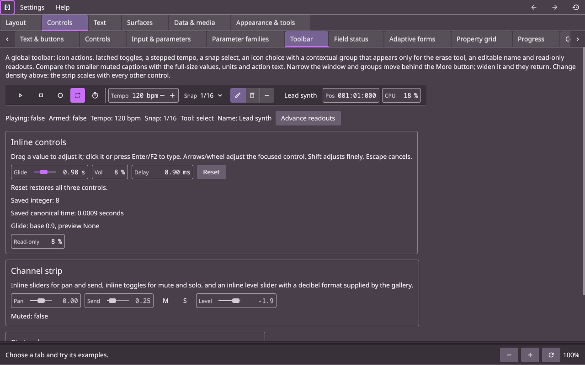
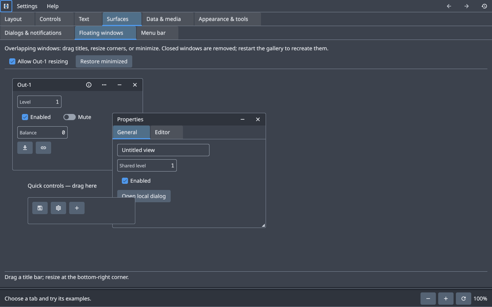
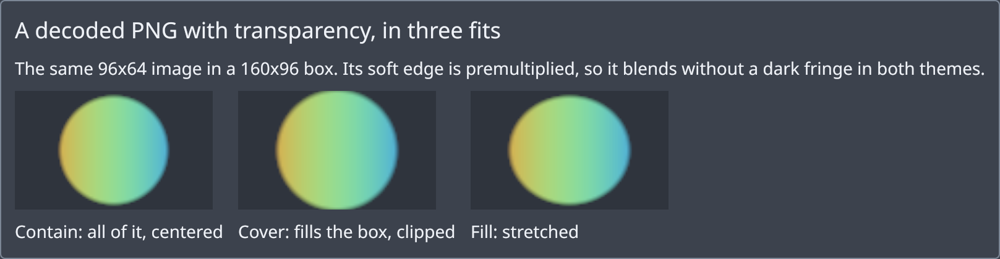

# pert-ui


**Build a capable desktop UI without building the UI framework around it.**

pert-ui is an opinionated Rust GUI library for dense, interactive applications.
Its default path brings windows, layout, text, controls, input and rendering
together. You provide the content and data; pert-ui handles presentation, retains
unchanged layout and drawing work, and lets an idle interface sleep.

## What makes pert-ui stand out?

- **A complete default path:** Start building an interface without first choosing
  a renderer, wiring an event loop or managing repaint timers.
- **Updates driven by change:** Bindings invalidate the parts of the interface
  that depend on them. Unchanged widgets retain their layout, text and drawing data.
- **Workspace components built in:** Compose tabs, split panes, tool windows,
  floating in-view windows, adaptive forms and virtualized collections.
- **Clear ownership of state:** Signals and typed parameters distinguish local
  UI state and edits from application-owned data.
- **UI you can inspect and capture:** Use the public inspection contract and
  headless CPU rendering to examine the interface your application produces.

## Is pert-ui a good fit?

**Choose pert-ui** if you want cohesive defaults, retained updates and workspace
components in one Rust library, while keeping application logic and data under
your control. Explore the [manual](docs/manual.md) and the gallery screenshots
below to see the current API and components.

**Choose another toolkit** if you need a published, stable dependency today,
platform accessibility integration, browser rendering or X11 support. Native
multi-window support is experimental, and native behavior has not yet been verified
across the full target platform matrix.

## Gallery screenshots

The Toolbar page uses a dark Violet palette and shows grouped actions,
editable values and compact controls.



Overlapping in-view windows can contain ordinary controls and nested tabs.



Image controls demonstrate contain, cover and fill with the same transparent PNG.



Browse the [screenshot catalog](docs/screenshots/README.md) for more components
and views, full-resolution PNGs and capture instructions. These headless CPU
captures have no native window chrome. The Toolbar uses the gallery's dark
Violet palette; the other images use the default dark palette.

## Development

Rust 1.99.1, edition 2024, is pinned in `rust-toolchain.toml` and is the declared
minimum supported version. The workspace packages are:

- `pert-ui-core`: parameter specs of every family, IDs and the synchronous edit protocol.
- `pert-ui-runtime`: backend-independent state, scheduling, input, inspection and drawing.
- `pert-ui-cpu`: software rendering of public drawing commands and captures.
- `pert-ui-wgpu`: hardware GPU adapter consuming the public drawing commands.
- `pert-ui`: public facade and default native window/event-loop integration.
- `pert-ui-gallery`: unpublished consumer depending only on the facade.
- `pert-ui-native-checks`: unpublished runner for the opt-in native checks, one
  process per check; see [verification](docs/verification.md). It also holds
  an experimental native input probe.

```sh
cargo run -p pert-ui-gallery
cargo run -p pert-ui-gallery -- --headless
cargo fmt --all --check
cargo clippy --locked --workspace --all-targets -- -D warnings
cargo test --locked --workspace
cargo test --locked --workspace --doc
cargo test --locked --release --workspace
RUSTDOCFLAGS="-D warnings" cargo doc --locked --workspace --no-deps
cargo package --locked --workspace --exclude pert-ui-gallery --exclude pert-ui-native-checks --list
cargo package --locked --workspace --exclude pert-ui-gallery --exclude pert-ui-native-checks
```

The default gallery groups one interactive page per implemented widget family
into category tabs, each with its own strip of pages,
including both bundled fonts, independent split/RegionLayout locks, retained
visibility, nested tabs, all scrolling axes and shared parameter edits.
Click buttons or use Tab and Enter/Space; focused tab strips use arrows and
Ctrl+Tab works from content. Live presentation is opt-in and suspends
when hidden. The fixed application frame keeps menus and tab headers stationary;
only tab content scrolls. Profiling is enabled explicitly in the demo, with
manual Refresh/Pause/Clear controls and no polling. See the [gallery guide](apps/gallery/README.md) for the examples.

`--headless` demonstrates shared parameters, gestures, simultaneous keys and owned
inspection without a window. The gallery tests also mount the actual native tree,
route input and prepare every tab at desktop and narrow fractional-DPI sizes.
Checkbox, Toggle, RadioGroup, SegmentedControl, Select, Slider, Popover, Menu and Tooltip are
implemented. Dialog, AlertDialog, ContextMenu, nested menu items, Banner and Toast
are also available. The [static/live workload](docs/verification.md#presentation-workload) pairs
1,000 retained checkboxes with synthetic UI-thread data visualizations and
separate work counters. Text/IME, clipboard editing and
integer/decimal inputs are available. The library ships no MCP server; an
application builds its own tooling on the
[inspection contract](docs/contracts.md#inspection-and-diagnostics). Unit
presets, platform accessibility and application-specific editing surfaces remain
future work. Window and widget capture are implemented. The
[architecture](docs/architecture.md#direction-and-limits) records proposed work;
the [verification record](docs/verification.md) separates native evidence from
outstanding checks. See the [public examples](crates/pert-ui/src/guide).
The doc command above uses POSIX shell syntax; in PowerShell set
`$env:RUSTDOCFLAGS = "-D warnings"` before running `cargo doc`.

[CI](.github/workflows/ci.yml) is configured for headless checks on Linux, macOS and Windows
with stable Rust, plus a separate pinned MSRV job. These checks do not certify
native GUI/GPU support on the [target platform matrix](docs/verification.md#native-evidence).
The [Cargo workspace packaging command](https://doc.rust-lang.org/cargo/commands/cargo-package.html)
verifies the library dependency chain together; this is a local rehearsal, not a crates.io
publication or registry dry run. The manifests declare the repository and each
library's docs.rs documentation URL; the crates.io names are not yet reserved and
the release owner is not yet settled. `Cargo.lock` is kept for reproducibility.
See the [verification record](docs/verification.md) for checks actually
run.
When repackaging changed unpublished code at the same version, use a fresh
`--target-dir` if Cargo reuses an earlier temporary-registry artifact.

## License

Licensed under either [MIT](LICENSE-MIT) or [Apache-2.0](LICENSE-APACHE), at your
option. Each library includes both texts in its package. When changing license
notices, keep the root and package copies synchronized.

## Documentation

- [Manual](docs/manual.md) — quick start and component construction.
- [Architecture](docs/architecture.md) — scope, boundaries and direction.
- [Contracts](docs/contracts.md) — state, editing, input and persistence.
- [Rendering and platform](docs/rendering-platform.md) — display and native behavior.
- [Verification](docs/verification.md) — checks, evidence and limitations.
- [Repository instructions](AGENTS.md) — contribution and review rules.

## Contributing and security

Read the [contribution guide](CONTRIBUTING.md) before opening a pull request.
For a suspected vulnerability, follow the [security policy](SECURITY.md) instead
of posting its details in a public issue.
